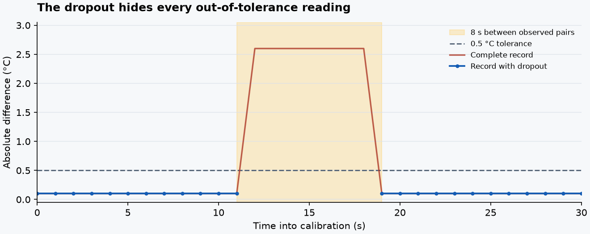

# Test Evidence Audit

**Check sensor agreement from a bench-test CSV.** Get a verdict in the terminal, see where the evidence is missing, and attach a JSON report to your test notes.

[Run the demo](#try-it-in-30-seconds) · [Use your own CSV](#use-your-own-csv) · [Read the verdict](#read-the-verdict)

**Python 3.10+** · **Offline** · **No dependencies**

## Try it in 30 seconds

```sh
git clone https://github.com/sharziki/test-evidence-audit.git
cd test-evidence-audit
python3 audit.py examples/logger_dropout.csv --profile examples/temperature.json
```

```text
INSUFFICIENT EVIDENCE
24 paired readings from 0 to 30 s
Largest measured difference: 0.1 (tolerance 0.5)
1 oversized gaps; longest 11 to 19 s (8 s)
```

The synthetic demo drops the seven readings that showed a 2.6 °C disagreement. The remaining readings agree within tolerance. The audit flags the missing interval so the run doesn’t get signed off as a pass.



## Use your own CSV

### 1. Save a profile

The CLI lists your headers and lets you select columns by number. Choose two channels in the same units and on the same clock, then enter your calibration window and acceptance limits.

```sh
python3 audit.py "run-01.csv" --setup calibration.json --report run-01-audit.json
```

### 2. Check the next run

Reuse the profile and give each report its own filename. Omit `--report` for a terminal summary only.

```sh
python3 audit.py "run-02.csv" --profile calibration.json --report run-02-audit.json
```

| Setup field | What to enter |
| --- | --- |
| Shared timestamp | PSP Liquids' `Dev5_BCLS_ai_time` uses nanoseconds. For another numeric clock, select its column and unit. |
| Sensor and reference | Two columns sampled on that clock, in the same units. |
| Start and duration | Seconds relative to the first timestamp in that clock. Select the calibration interval, and override with `--start-s` or `--duration-s` if it shifts between runs. |
| Tolerance | Maximum acceptable absolute difference, in sensor units. |
| Maximum gap | Longest allowed interval between paired observations, in seconds. Use your protocol limit. |
| Difference uncertainty | An absolute uncertainty bound on the measured difference, if your calibration protocol supplies one. Accepting zero evaluates the recorded values directly. |

Profiles save settings only. Review them before sharing or reusing them on a different setup. For PSP Parquet logs, convert to wide CSV first. On Windows, use `py -3` in place of `python3` if needed. [PSP CSV example](https://github.com/Purdue-Space-Program/simple_data_plotter/blob/932299158ccd1d2844c414de53847023ba1edf46/utils/test_data_truncated.csv) · [PSP Parquet converter](https://github.com/Purdue-Space-Program/simple_data_plotter/blob/932299158ccd1d2844c414de53847023ba1edf46/utils/parquet_to_csv_converter.py)

## Read the verdict

| Verdict | Meaning | Exit code |
| --- | --- | --- |
| Pass | All measured differences, including the supplied uncertainty bound, fit within tolerance, and the window meets the sampling rule. | 0 |
| Fail | At least one observed difference exceeds tolerance even after subtracting its uncertainty bound. | 1 |
| Insufficient evidence | Coverage is too sparse or a reading's uncertainty interval crosses the tolerance, with no confirmed failure. | 3 |

An invalid input exits with code 2. Confirmed failure takes precedence, and the report still lists coverage and uncertainty issues. The audit counts gaps between paired observations and at both window edges. Blank or NaN readings contribute no pair. It assumes a common clock and can only assess the samples and calibration limits you give it.

Use `--json` to print the detailed report to stdout with a profile, `--list-columns` to print headers only, and `--help` for all options. The report includes paired-sample count, exact gap intervals, largest measured difference, and signed mean difference.

## Common setup fixes

| If you see… | Check… |
| --- | --- |
| Missing or unknown column | Run `python3 audit.py "my run.csv" --list-columns` and use the exact headers. |
| Too few pairs or an oversized gap | Verify the timestamp unit, calibration window, and whether both channels have readings in that interval. |
| Shared clock must be strictly increasing | Check for duplicate timestamps, clock resets, or rows out of order. |
| Output already exists | Give the new report its own filename so you keep the previous result. |

## Development

Run `python3 -m unittest -v`. The included calibration fixtures are synthetic. A public PSP Liquids CSV was used for format testing. MIT licensed.
